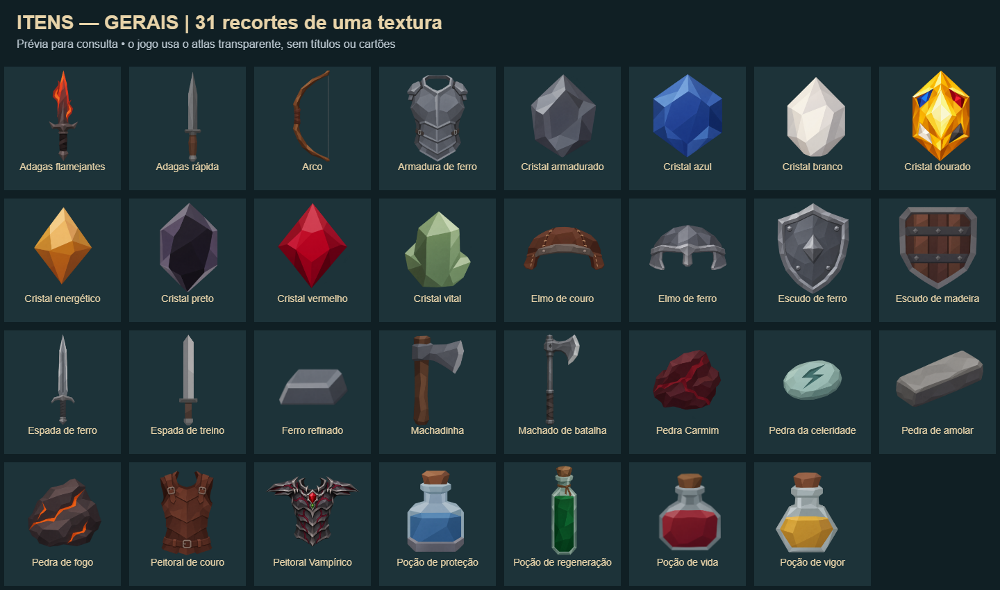

# Atlas dos equipamentos

Os 31 equipamentos atuais compartilham uma imagem transparente. Cada arte ocupa
um retângulo nomeado pelo ID do item; o jogo exibe somente esse recorte.



Essa prévia com nomes serve para consulta. O jogo usa o [atlas WebP transparente](../../../public/assets/atlases/items-general.webp),
também disponível em [PNG](../../../public/assets/atlases/items-general.png),
com o [mapa JSON dos recortes](../../../public/assets/atlases/items-general.json).

Exemplo real de uso no Phaser:

```js
scene.add.image(x, y, 'items-general', 'sword');
scene.add.image(x, y, 'items-general', 'shield');
```

As duas imagens acima compartilham a mesma textura. `src/utils/itemArt.js`
resolve o recorte para todas as telas, inclusive cópias dos itens, rotações e
exportação da mochila vencedora. As dimensões originais são preservadas; os
formatos de colisão e encaixe continuam definidos pelos dados dos itens.

## Arquivos e grupos

- Atlas geral: `public/assets/atlases/items-general.webp`, 2000 × 1212 pixels,
  277.644 bytes. Alternativa PNG na mesma pasta.
- Recortes: `public/assets/atlases/items-general.json`, com 31 frames. O mapa é
  incluído no JavaScript durante o build; o navegador precisa requisitar apenas
  a imagem do atlas, sem outra requisição de JSON.
- Registro gerado: `src/data/itemAtlases.js`.
- Fontes individuais preservadas: `public/assets/items/`.
- Gerador: `scripts/prepare-item-atlases.mjs`, executado por `npm run assets:items`.

O gerador separa automaticamente por `pool` do catálogo. Hoje todos os itens
com arte são `general`; não há equipamentos exclusivos do Arthur. Quando forem
adicionados itens com `pool: 'arthur'` e suas artes no registro `itemArt`, o
comando produzirá também `items-arthur.webp`, PNG, JSON e uma prévia. Loja,
batalha e mochila vencedora selecionam os atlas gerais e os da classe da jornada;
o catálogo carrega todos os grupos para permitir consulta.

O carregamento continua por etapa: o menu não baixa os atlas. Texturas já
carregadas são reutilizadas nas visitas seguintes. Se WebP falhar, o loader
tenta o atlas PNG com os mesmos recortes.

O empacotamento não gira nem redimensiona as artes. Tenta diferentes arranjos
MaxRects para reduzir espaços vazios, limita cada textura a 2048 pixels por
dimensão e adiciona dois pixels de extensão das bordas mais margem transparente
para reduzir contaminação entre recortes ao filtrar a imagem.

## Ganhos e limites

As artes separadas somavam 298.250 bytes em 31 requisições. O atlas WebP soma
277.644 bytes em **uma requisição**: cerca de **6,9% menos bytes de imagem** e
30 requisições a menos na primeira loja. A melhora de FPS e de tempo da loja
depende do dispositivo e não é garantida apenas pela quantidade de arquivos.
Uma amostra sob a mesma limitação de CPU/rede do teste de lazy loading marcou
1,91 s para a primeira loja antes do atlas e 2,04 s depois. São amostras únicas,
insuficientes para concluir ganho de tempo; não foi medido ganho de FPS.

Também há um custo de espaço vazio na textura: a estimativa RGBA passa de
8.227.840 para 9.696.000 bytes, sem contar outras estruturas do navegador/GPU.
O atlas reduz fontes de textura; não deve ser interpretado como economia
automática de memória de vídeo.

Validações: build, 238 testes de lógica/geometria, smoke das artes em WebP e PNG,
e diagnóstico de produção com todos os 31 equipamentos. O teste verifica que há
31 recortes em uma única fonte, sem requisições às imagens individuais. Os
testes de geometria conferem dimensões originais, classe, bordas, ausência de
recortes sobrepostos e fallback para itens sem arte.
